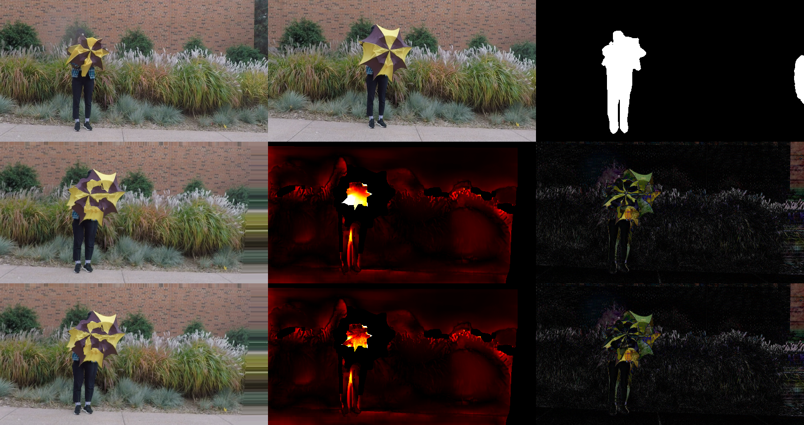
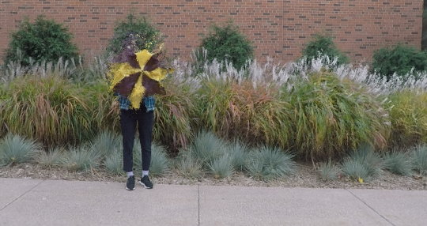
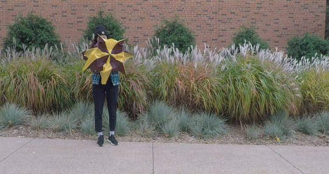

<div align="center">
<h1>DynPoint: Dynamic Neural Point For View Synthesis</h1>

Full PyTorch reimplementation of the NeurIPS 2023 paper: consistent depth → surface scene flow → hierarchical neural point clouds → point-based rendering.<br>
One GPU, no custom CUDA, <b>~19 min per scene</b> (7 min fast setting).

<a href="https://arxiv.org/abs/2310.18999"></a>
<a href="https://proceedings.neurips.cc/paper_files/paper/2023"></a>
<a href="https://dynpoint.github.io/"></a>

**[University of Oxford](https://www.cs.ox.ac.uk/)**

[Kaichen Zhou](https://kaichen-z.github.io/), Jia-Xing Zhong, Sangyun Shin, Kai Lu, Yiyuan Yang, Andrew Markham, Niki Trigoni
</div>

```bibtex
@inproceedings{zhou2023dynpoint,
  title     = {DynPoint: Dynamic Neural Point For View Synthesis},
  author    = {Zhou, Kaichen and Zhong, Jia-Xing and Shin, Sangyun and Lu, Kai and Yang, Yiyuan and Markham, Andrew and Trigoni, Niki},
  booktitle = {Advances in Neural Information Processing Systems (NeurIPS)},
  year      = {2023}
}
```

<p align="center"></p>
<p align="center"><em>Stage 1 — scene flow. Row 1: target frame, reference frame (+3), dynamic mask. Row 2: reference warped to the target with consistent depth only; flow re-projection error (red); photometric error. Row 3: the same with depth + scene flow — the error on the moving umbrella vanishes.</em></p>

<p align="center"> </p>
<p align="center"><em>Stage 2 — view synthesis. Novel view synthesised from the monocular video (left) vs. held-out camera (right); <code>results/umbrella/view_synthesis/demo.mp4</code>: input | novel view | depth.</em></p>

## Overview

DynPoint synthesises novel views of a dynamic scene from a single monocular video without learning a canonical latent representation. It estimates explicit 3D correspondences between a target frame and its 2K neighbouring frames (consistent depth + surface scene flow), aggregates the neighbours into a hierarchical neural point cloud, and renders with a Point-NeRF-style MLP. The released repository only contains stage 1; this code rebuilds the whole method and adds a few training improvements (listed under *Differences from the paper*).

| Paper | Module | What it does |
|---|---|---|
| Sec. 3.2 consistent depth | `dynpoint/preprocess.py`, `geometry.py`, `priors.py` | RAFT optical flow to the 2K nearest frames, monocular depth prior (Depth-Anything-V2 or the authors' MiDaS checkpoint), correspondence / geometric-edge / dynamic masks (Eq. 1), mid-point triangulation, robust parallax-weighted affine depth fit (Eq. 2) |
| Sec. 3.3 scene flow | `dynpoint/sceneflow.py` | 1x1-conv MLP F(P, t) → forward / backward flow, chained over gaps (Eq. 6), flow re-projection + depth + cycle losses (Eq. 4, 5); joint per-frame depth refinement from multi-view flow consistency |
| Sec. 3.4 view synthesis | `dynpoint/render.py`, `train_render.py` | 3-level neural point cloud from the target frame and 2K warped references (Eq. 7), CNN point features with per-point learnable residuals / confidences, feature / density / colour nets (Fig. 8), volume rendering (Eq. 9) |
| In-the-wild videos | `dynpoint/prepare_wild.py` | poses + intrinsics + depth prior from Depth-Anything-3 (no COLMAP) |
| Visualisation | `dynpoint/visualize_flow.py`, `dynpoint/export_viewer.py` | stage-1 warp/error figure + PLY; one-frame 3D point cloud + scene-flow vectors for the interactive web viewer (`page/static/js/viewer.js`) |
| Evaluation | `dynpoint/metrics.py`, `tests/` | PSNR / SSIM / LPIPS, geometry self-checks, timing |

## Quick Start

```bash
git clone <this repo> dynpoint && cd dynpoint
conda create -n dynpoint python=3.11 -y && conda activate dynpoint
pip install torch torchvision            # CUDA build matching your driver
pip install -r requirements.txt          # RAFT / ResNet-18 / Depth-Anything-V2 weights download on first use

bash run_toy.sh                          # synthetic scene with exact geometry: end-to-end smoke test, ~2 min
bash scripts/download_nvidia.sh          # Nvidia Dynamic Scene dataset (NSFF release, 3.4 GB) -> data/nsff_<scene>
bash run_full.sh data/nsff_Umbrella 0    # full setting on GPU 0, ~19 min
bash run_fast.sh data/nsff_Umbrella 0    # fast setting, ~7 min
```

Two settings, identical pipeline, one knob (render-training iterations):

| Setting | Script | Render iters | Time / scene (24 frames, 540x288, one RTX PRO 6000) | Quality |
|---|---|---|---|---|
| full | `run_full.sh` | 20,000 | preprocess 17 s + scene flow 170 s + render 765 s + eval 170 s + video 20 s ≈ **19 min** | table below |
| fast | `run_fast.sh` | 4,000 | render 180 s ≈ **7 min** | ≈ −0.3 dB PSNR, +0.05 LPIPS |

Outputs in `<scene>/work/`: `priors.pt` (flows, masks, consistent depth), `sceneflow.pt`, `render.pt`, `eval/{pred,gt,depth}_<t>_<cam>.png` + `metrics.json`, `demo.mp4` (input | novel view | depth), `flow_vis/` (stage-1 figure as above + coloured point cloud `.ply`), `log.txt`.

Stages can be run individually:
```bash
python -m dynpoint <toy|preprocess|train_flow|train_render|eval|video|all> --scene DIR [--work DIR] [flags]
python -m dynpoint.visualize_flow --scene DIR --t 8 --gap 3      # stage-1 figure + point cloud
python -m dynpoint.export_viewer --scene DIR --t 12 --gap 3 --out viewer/scene.bin   # 3D point cloud + scene flow for the web viewer
python -m dynpoint video --scene DIR ... --video_times 6,12,18 --sweep 24           # synthesise 3 frames, camera sweep per frame
```
Flags: `--K` references per side (6), `--depth midas|dav2|gt`, `--refine_depth all|dyn`, `--sf_wsfmin` scene-flow magnitude prior (1; 0 for large object motion such as Truck), `--attn`, `--p_loo` leave-one-out probability (0.7), `--radius_px` (6), `--nr_iters`, `--max_eval_views`, `--trust_depth` (skip the affine fit when the depth prior is already consistent with the poses), `--k_dyn` (dynamic points only from references within this gap), `--cam_path interp|orbit` and `--span` / `--orbit` (demo-video camera path).

Visualisation cleanup (inference only, used for the videos; costs ≈0.6 dB PSNR but removes flying points): `--edge_thresh 0.12 --sharp 2 --conf_min 0.2` — prune reference points at depth discontinuities, sharpen the neighbour weighting, drop low-confidence points. Do not use `--edge_thresh` on wild scenes whose depth prior is noisy. Training-time culling: `--mv_thresh 3` (default in the scripts). Tried without gain: `--prune_every` (confidence pruning never fires), `--dyn_band`, `--color_tol`, `--k_dyn 0`.

## In-the-wild videos

No camera information needed. Poses, intrinsics and a depth prior come from [Depth-Anything-3](https://github.com/ByteDance-Seed/Depth-Anything-3) (feed-forward); a segmentation of the moving object (e.g. DAVIS annotations, or any video segmenter) is used as the dynamic mask.

```bash
export PYTHONPATH=/path/to/Depth-Anything-3/src:$PYTHONPATH
python -m dynpoint.prepare_wild --frames "DAVIS/JPEGImages/480p/goat/*.jpg" \
       --masks "DAVIS/Annotations/480p/goat/*.png" --out data/wild_goat --max_frames 40
bash run_full.sh data/wild_goat 0 --depth gt --trust_depth --k_dyn 1 --sharp 2 --conf_min 0.2   # DA3 depth as prior, dynamic points from the nearest references only
```
`results/` and the project page show DAVIS sequences that are not in the paper (goat, camel, bear) processed this way.

## Your own data layout

```
scene/image/image_%05d.png       frames
scene/camera/camera_%05d.npz     intrinsic (3x3), extrinsic (4x4 camera-to-world, OpenCV: x right, y down, z forward)
scene/motion/mask_%05d.png       optional dynamic mask (255 = moving); otherwise Sampson-error masks are computed
scene/depth/depth_%05d.npy       optional depth prior (used by --depth gt)
scene/test/image_%05d_%02d.png   optional held-out views (time, camera id) with camera_%05d_%02d.npz
```
`dynpoint.data.convert_nvidia_scene` converts LLFF `poses_bounds.npy` folders (DynamicNeRF / NSFF layout); `tests/check_nvidia.py` checks poses and depth against a COLMAP sparse model.

## Results

Quantitative results are reported in the tables of the [paper](https://arxiv.org/abs/2310.18999).

## Differences from the paper

* Priors: torchvision RAFT (paper: FlowFormer); Depth-Anything-V2 aligned in disparity space (paper: DPT). The authors' MiDaS checkpoint is supported (`--depth midas --depth_ckpt midas_cpkt.pt`).
* The depth network is frozen; a per-frame log-depth correction is optimised jointly with the scene flow under a scene-flow magnitude prior (on a near-collinear camera rig a dynamic-object depth error is otherwise indistinguishable from motion along the baseline).
* The rendering MLP is trained from scratch per scene (paper: pre-trained on DTU) with per-point learnable feature residuals and confidences, learned neighbour attention and leave-one-out training (the target frame's own points are dropped with probability 0.7 so the training camera behaves like a novel view).
* Neighbour search is a pixel-bucketed projection with a depth-relative radius instead of a kNN kernel.
* Known gaps: moving-object regions render at 15–18 dB; LPIPS is about 1.8x the paper's; Playground and Skating are 4–5 dB below.

## Tests

```bash
python tests/check_geometry.py data/toy                 # triangulation / affine-fit exactness on the toy scene
python tests/check_nvidia.py data/nvfull_tmp/nvidia_data_full/Umbrella/dense data/nsff_Umbrella
python tests/check_static_warp.py data/nsff_Umbrella    # depth re-projection error per temporal gap
python tests/eval_regions.py data/nsff_Umbrella/work/eval data/nvfull_tmp/nvidia_data_full/Umbrella/dense
python tests/timing.py data/nsff_*/work
```

## Legacy code

The original 2023 release (stage 1 only: FlowFormer + MiDaS preprocessing and the scene-flow MLP) is kept under `legacy/` for reference.

## Acknowledgements

Flow from [RAFT](https://github.com/princeton-vl/RAFT) (torchvision); depth from [Depth-Anything-V2](https://github.com/DepthAnything/Depth-Anything-V2), [Depth-Anything-3](https://github.com/ByteDance-Seed/Depth-Anything-3) and [MiDaS](https://github.com/isl-org/MiDaS); rendering design after [Point-NeRF](https://github.com/Xharlie/pointnerf); Nvidia data from [NSFF](https://github.com/zl548/Neural-Scene-Flow-Fields); DAVIS videos from [DAVIS 2017](https://davischallenge.org/).
